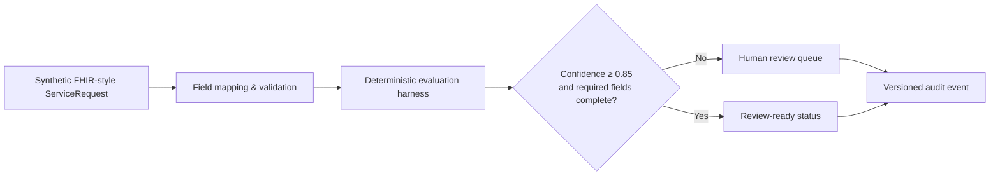

# Clinical Flow — Healthcare FDE Case Study

A privacy-safe case study showing how a Forward-Deployed Engineer turns a clinical-operations question into a scoped, reviewable workflow.

> **Safety boundary:** all records are synthetic. This is not a medical device, does not process PHI, and must not be used for clinical decision-making.

## The use case

**Stakeholder question:** “Can we surface incomplete referral records before they delay specialist review?”

The demonstration never makes an automatic clinical decision. A missing required field routes the referral to a human reviewer.

## Architecture



## Repository layout

```text
clinical-flow-fde/
├── data/referral_2048.json        # synthetic FHIR-style input
├── scripts/evaluate_referral.py   # dependency-free evaluation harness
├── dist/index.html                # interactive case-study demo
└── README.md
```

## Run the evaluation

Requires Python 3.10+; no packages are needed.

```bash
python scripts/evaluate_referral.py data/referral_2048.json
```

Expected result: `NEEDS_HUMAN_REVIEW`, because the synthetic referral intentionally lacks a symptom-onset date.

## What this demonstrates

- **Discovery:** stakeholder language becomes a bounded operational use case.
- **Implementation:** source data is mapped into explicit, inspectable checks.
- **Evaluation:** thresholds and contributing signals are visible, not hidden behind an AI claim.
- **Safety:** uncertainty is sent to a person; no autonomous clinical action occurs.
- **Product thinking:** versioned outputs help turn recurring deployment work into reusable product capabilities.

## Production next steps

For production, I would add authenticated API integration, validation against the customer’s FHIR implementation guide, role-based access, encrypted audit storage, monitoring, and customer-specific acceptance tests. These are intentionally out of scope for this static demonstrator.
